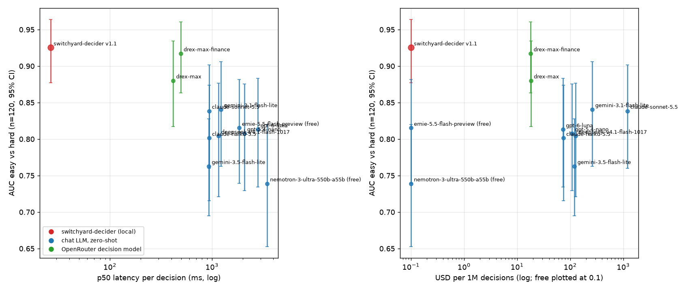

# Benchmarks

## Holdout (v1.2)

`benchmarks/holdout/holdout.jsonl` holds 200 frozen rows (sha256
`967dc16e4d61e90ed14a1f4c048a14be285264f8193a1b14b211a87ed6c61357`). It was built to show whether a model routes on
input length instead of on the ask:

| subset | rows | content |
|---|---|---|
| short_easy, short_hard | 35 + 35 | short asks (controls) |
| long_easy, long_hard | 35 + 35 | asks after long logs, JSON or code pastes |
| pair_easy, pair_hard | 20 + 20 | matched pairs: the same paste with an easy ask and with a hard ask |
| borderline | 20 | medium asks, excluded from AUC |

The asks were written by an LLM. `benchmarks/holdout/make_holdout.py` (with `gens.py` and `cores.py`) assembles them
deterministically and reproduces the file byte for byte. The holdout was frozen before any v1.2 metric existed. It
was never used for training or tuning, and it was scored once, on the chosen run.

Leakage checks (`training/retune/holdout_qa.py`, `leak_check.py`, `leak_bow.py`):

| check | result |
|---|---|
| exact matches vs train3, aug_train, devaug, fresh100 | 0 |
| near-duplicates (8-gram overlap ≥ 50%) | 0 |
| length-only AUC | 0.5065 |
| TF-IDF logistic regression, 5-fold CV AUC | 0.597 |
| bag-of-words ridge trained on the augmentation rows, scored on the holdout | 0.574 / 0.582 |

Results, served end to end (`training/retune/accept_final.py`):

| metric | v1.1 | v1.2 |
|---|---|---|
| hard-vs-easy AUC | 0.8396 | **0.9794** |
| matched pairs ordered correctly (easy scored easier) | 13/20 | 19/20 |
| long_easy on the wrong side of the cutoff | 30/35 | 13/35 |
| pair_easy on the wrong side | 16/20 | 8/20 |
| short_hard on the wrong side | 2/35 | 0/35 |
| short_easy, long_hard, pair_hard, borderline on the wrong side | 0 | 0 |

AUC difference +0.1398; a paired bootstrap with 2,000 resamples gives a 95% lower bound of +0.0906.

Other sets:

| set | v1.1 | v1.2 | note |
|---|---|---|---|
| val2 AUC | 0.8952 | 0.8966 | validation split used for the gate |
| fresh100 AUC | 0.9908 | 0.9956 | 100 recent prompts |
| dev-aug AUC | 0.7312 | 0.9576 | built like the training augmentation, so optimistic |

### Latency (v1.2 harness)

`training/retune/bench_latency.py <model_dir>` times the served path end to end for each holdout text. That covers
the 20,000-character cut, tokenization, the head+tail cut, the forward pass and the ridge probe. It runs at batch 1,
fp16, on Apple M4 Max (48 GB) MPS.

| model | p50 | p90 |
|---|---|---|
| v1.1 | 64.0 ms | |
| v1.2 | 62.8 ms | 64.9 ms |

Most holdout texts are long (120 of 200 exceed 768 tokens), and this harness includes their tokenization. The
[Speed](#speed) table below uses a forward-pass harness on short validation prompts, so the two are not comparable.
Neither model meets a 40 ms goal on long inputs, because batch-1 MPS inference is bound by kernel launch overhead.

## Accuracy (validation, v1.0 and v1.1)

Validation set: 1,994 held-out prompts (easy vs hard pairs; medium excluded from AUC).

| model | AUC (labels) | AUC (arena) | AUC (coding) | hard → frontier @40% | easy → mid-tier @40% |
|---|---|---|---|---|---|
| **+ ridge probe on embedding (v1.1, served)** | **0.895** | | | | |
| this model (step 3600, head only, v1.0) | 0.886 | 0.769 | 0.929 | 0.693 | 0.862 |
| same recipe without gold head | 0.859 | | | | |
| previous LLM decider (0.8B, MLX 4-bit) | 0.687 | | | 0.538 | 0.712 |

Columns:

- AUC (labels): easy vs hard on the combined validation label.
- AUC (arena): easy vs hard on the arena-derived label only.
- AUC (coding): easy vs hard restricted to prompts in the coding domain.
- hard → frontier @40% and easy → mid-tier @40%: when the hardest 40% of requests go to the frontier model, the share
  of hard requests sent to the frontier model and the share of easy requests kept on the mid-tier model.

Caveat: the checkpoint was chosen on this validation set, so these numbers are slightly optimistic.

Reproduce with `switchyard_decider/predict.py` to write logits, then `benchmarks/evalp.py <logits.npy>...` from the
data directory (needs `val.jsonl` with `label`, `arena` and `domain` fields).

## Teacher comparison

On a fixed 300-prompt subset used to benchmark about 40 OpenRouter decision models, this model scores AUC 0.904. The
best teachers scored 0.879 (`nace-ai/drex-max-finance`), 0.873 (`nace-ai/drex-max`) and 0.871
(`perplexity/pplx-decider-v1.3`). Combining labels from several teachers with independent errors beats any single
teacher.

Reproduce with `benchmarks/bench_dec.py [model...]` (needs `OPENROUTER_API_KEY`; `N` sets the subset size, default
300; `CAP` stops when account usage reaches that many dollars). Results are cached per model in `dec_bench/`.

## Speed

Measured on v1.1 (v1.2 has the same architecture and input cap of 768 tokens). Apple M4 Max (48 GB), PyTorch, single request, batch 1. Forward pass only at fixed lengths; "real prompts" includes
tokenization on the 1,994 validation prompts (median 80 tokens). The ridge probe adds one 2048-wide dot product.

| tokens | MPS fp16 p50 | MPS fp16 p95 | CPU fp32 p50 | CPU fp32 p95 |
|---|---|---|---|---|
| 32 | 11.4 ms | 11.7 ms | 49.4 ms | 55.3 ms |
| 128 | 17.7 ms | 18.1 ms | 125.1 ms | 141.7 ms |
| 256 | 27.6 ms | 29.3 ms | 150.3 ms | 161.1 ms |
| 512 | 107.8 ms | 320.3 ms | 294.1 ms | 317.5 ms |
| 768 | 145.4 ms | 161.6 ms | 473.3 ms | 522.6 ms |
| real prompts | 30.2 ms (p99 151 ms) | 107.5 ms | 78.7 ms (p99 320 ms, 200 prompts) | 219.0 ms |

Through the HTTP server on MPS (500 prompts): p50 23 ms, p95 74 ms, p99 97 ms. Model load 0.7 s, resident memory
about 560 MB. The previous LLM decider took about 720 ms per decision.

Reproduce with `python benchmarks/bench_speed.py <model_dir> <mps|cuda|cpu> [prompts.jsonl]`, which reports forward
latency at fixed token lengths and, if a prompts file is given, end-to-end latency on real prompts.


## Comparison with OpenRouter models

Measured on v1.1. This comparison was not rerun for v1.2, and none of the numbers below are v1.2 numbers.

Same task for every model: rank 120 validation prompts (55 easy, 65 hard, a seeded random sample of the easy/hard
pairs) from easiest to hardest. AUC is the probability that a random easy prompt is ranked easier than a random hard
one; 95% intervals are bootstrap percentiles (2,000 resamples). With n=120 the intervals are wide and overlap for the
top models, so read the ordering among the top five as uncertain. Our checkpoint was selected on this validation set,
so its number is optimistic.

### Efficiency

Latency is end-to-end per decision, measured sequentially from the same machine. Ours is the HTTP server on
localhost; OpenRouter models include network and queueing time. Tokens and cost come from the `usage` field that
OpenRouter returns. Ours uses no API tokens and costs $0 in API fees, so a cost ratio against it is undefined;
it needs about 565 MB of memory on the local machine instead.

| model | kind | params | runs on | p50 ms | p95 ms | tokens/decision | $ / 1M decisions | p50 vs ours | AUC (95% CI) |
|---|---|---|---|---|---|---|---|---|---|
| switchyard-decider v1.1 | ours | 395M | local, Apple M4 Max (MPS) | 26 | 76 | 0.0 | 0.00 | 1x | 0.925 (0.877-0.964) |
| nace-ai/drex-max-finance | decision | n/a | OpenRouter API | 494 | 1079 | 0.0 | 18.03 | 19x slower | 0.917 (0.863-0.960) |
| nace-ai/drex-max | decision | n/a | OpenRouter API | 418 | 863 | 0.0 | 18.21 | 16x slower | 0.880 (0.817-0.934) |
| google/gemini-3.1-flash-lite | chat | n/a | OpenRouter API | 1226 | 1572 | 401.2 | 261.98 | 47x slower | 0.841 (0.763-0.906) |
| anthropic/claude-sonnet-5.5 | chat | n/a | OpenRouter API | 937 | 2780 | 443.8 | 1201.18 | 36x slower | 0.839 (0.760-0.902) |
| baidu/ernie-5.5-flash-preview:free | chat | n/a | OpenRouter API | 1840 | 3395 | 451.5 | 0.00 | 70x slower | 0.815 (0.739-0.881) |
| openai/gpt-6-luna | chat | n/a | OpenRouter API | 2801 | 4424 | 352.9 | 73.39 | 107x slower | 0.813 (0.734-0.883) |
| openai/gpt-5.4-nano | chat | n/a | OpenRouter API | 2074 | 2666 | 302.7 | 108.61 | 79x slower | 0.808 (0.730-0.875) |
| deepseek/deepseek-v4.1-flash-1017 | chat | n/a | OpenRouter API | 1155 | 3895 | 431.9 | 126.34 | 44x slower | 0.804 (0.721-0.876) |
| anthropic/claude-haiku-5.5 | chat | n/a | OpenRouter API | 939 | 2819 | 472.9 | 74.47 | 36x slower | 0.801 (0.715-0.874) |
| google/gemini-3.5-flash-lite | chat | n/a | OpenRouter API | 932 | 1321 | 286.2 | 120.92 | 35x slower | 0.763 (0.695-0.828) |
| nvidia/nemotron-3-ultra-550b-a55b:free | chat | 550B (55B active) | OpenRouter API | 3472 | 13486 | 553.2 | 0.00 | 132x slower | 0.739 (0.653-0.820) |



At this sample size, switchyard-decider is in the same accuracy range as the best OpenRouter decision model
(drex-max-finance, 0.917) and 19x faster at p50. It is clearly ahead of every zero-shot chat LLM tested (best:
gemini-3.1-flash-lite, 0.841, 47x slower, $262 per 1M decisions).

### Accuracy

Chat LLMs get the same rubric as the decision models and are asked for `{"p_frontier": 0-100}` (temperature 0,
reasoning effort `low`, max 2,048 output tokens); the score is `1 - p_frontier/100`. Decision models are scored
through the OpenRouter decisions API with the bench_dec questions. "AUC on 300" uses a larger sample that includes the 120;
chat models were only run on 120. Routing columns send exactly 40% of prompts to the frontier model, breaking ties at random.

| model | kind | n | failures | AUC (95% CI) | AUC coding | hard → frontier @40% | easy → mid-tier @40% | AUC on 300 |
|---|---|---|---|---|---|---|---|---|
| switchyard-decider v1.1 | ours | 120 | 0 | 0.925 (0.877-0.964) | 0.965 | 0.677 | 0.927 | 0.9092 |
| baseten/mammoth-1 | decision | 120 | 0 | 0.918 (0.867-0.960) | 1.000 | 0.692 | 0.945 | 0.8703 |
| nace-ai/drex-max-finance | decision | 120 | 0 | 0.917 (0.863-0.960) | 1.000 | 0.692 | 0.945 | 0.8789 |
| perplexity/pplx-decider-v1.3:free | decision | 120 | 0 | 0.905 (0.849-0.954) | 0.985 | 0.662 | 0.909 | 0.8711 |
| openai/gpt-6-luna-decisions | decision | 85 | 35 | 0.894 (0.819-0.958) | 0.956 | 0.574 | 0.903 | 0.7804 |
| liquid/d1.2-ultra | decision | 120 | 0 | 0.894 (0.829-0.944) | 1.000 | 0.692 | 0.945 | 0.853 |
| ~liquid/d1-ultra-latest | decision | 120 | 0 | 0.892 (0.828-0.943) | 1.000 | 0.692 | 0.945 | 0.8537 |
| nace-ai/drex-max | decision | 120 | 0 | 0.880 (0.817-0.934) | 0.989 | 0.677 | 0.927 | 0.8732 |
| ~perplexity/pplx-decider-latest | decision | 120 | 0 | 0.879 (0.810-0.935) | 0.983 | 0.646 | 0.891 | 0.8612 |
| perplexity/pplx-decider-v1.2 | decision | 118 | 2 | 0.875 (0.812-0.932) | 0.976 | 0.651 | 0.891 | 0.8581 |
| perplexity/pplx-decider-flash-v1.3:free | decision | 120 | 0 | 0.858 (0.790-0.921) | 0.963 | 0.646 | 0.891 | 0.8165 |
| ~typesafe/jev-latest | decision | 120 | 0 | 0.856 (0.787-0.918) | 0.989 | 0.631 | 0.873 | 0.8074 |
| parallel/decisions-fast | decision | 120 | 0 | 0.855 (0.785-0.916) | 0.983 | 0.615 | 0.855 | 0.7601 |
| liquid/d1.1 | decision | 120 | 0 | 0.854 (0.784-0.913) | 0.998 | 0.600 | 0.836 | 0.8053 |
| liquid/d1.2 | decision | 120 | 0 | 0.851 (0.781-0.913) | 0.991 | 0.600 | 0.836 | 0.8032 |
| liquid/d1-ultra | decision | 120 | 0 | 0.849 (0.771-0.910) | 0.983 | 0.662 | 0.909 | 0.8138 |
| typesafe/jev-1.14 | decision | 120 | 0 | 0.846 (0.773-0.909) | 0.990 | 0.600 | 0.836 | 0.8039 |
| google/gemini-decision-1 | decision | 120 | 0 | 0.845 (0.772-0.907) | 0.996 | 0.615 | 0.855 | 0.8105 |
| liquid/d1 | decision | 120 | 0 | 0.844 (0.764-0.915) | 0.989 | 0.692 | 0.945 | 0.8083 |
| baseten/elephant-1 | decision | 120 | 0 | 0.841 (0.769-0.905) | 0.994 | 0.600 | 0.836 | 0.8151 |
| google/gemini-3.1-flash-lite | chat | 120 | 0 | 0.841 (0.763-0.906) | 1.000 | 0.708 | 0.964 |  |
| anthropic/claude-sonnet-5.5 | chat | 120 | 0 | 0.839 (0.760-0.902) | 1.000 | 0.662 | 0.909 |  |
| morph/reflex | decision | 120 | 0 | 0.835 (0.754-0.899) | 0.959 | 0.615 | 0.855 | 0.8304 |
| respan/span-02 | decision | 120 | 0 | 0.833 (0.759-0.900) | 0.950 | 0.631 | 0.873 | 0.7554 |
| heygen/heygen-decision-1 | decision | 120 | 0 | 0.833 (0.753-0.908) | 0.991 | 0.615 | 0.855 | 0.8214 |
| microsoft/microsoft-decision-1 | decision | 120 | 0 | 0.832 (0.760-0.899) | 0.978 | 0.569 | 0.800 | 0.789 |
| ~liquid/d1-latest | decision | 120 | 0 | 0.832 (0.759-0.899) | 0.985 | 0.615 | 0.855 | 0.8057 |
| typesafe/jev-1.13 | decision | 120 | 0 | 0.831 (0.758-0.898) | 0.994 | 0.569 | 0.800 | 0.7912 |
| cloudflare/clef-flash | decision | 120 | 0 | 0.826 (0.744-0.896) | 0.972 | 0.646 | 0.891 | 0.8101 |
| heygen/heygen-decision-1-turbo | decision | 120 | 0 | 0.825 (0.746-0.900) | 0.991 | 0.600 | 0.836 | 0.8198 |
| baidu/ernie-5.5-flash-preview:free | chat | 120 | 0 | 0.815 (0.739-0.881) | 0.941 | 0.631 | 0.873 |  |
| openai/gpt-6-luna | chat | 120 | 0 | 0.813 (0.734-0.883) | 0.960 | 0.662 | 0.909 |  |
| cloudflare/clef | decision | 120 | 0 | 0.813 (0.726-0.889) | 0.994 | 0.677 | 0.927 | 0.8045 |
| nace-ai/drex-v1.5 | decision | 120 | 0 | 0.809 (0.724-0.886) | 0.898 | 0.631 | 0.873 | 0.7769 |
| openai/gpt-5.4-nano | chat | 120 | 0 | 0.808 (0.730-0.875) | 0.978 | 0.631 | 0.873 |  |
| deepseek/deepseek-v4.1-flash-1017 | chat | 120 | 0 | 0.804 (0.721-0.876) | 1.000 | 0.646 | 0.891 |  |
| microsoft/microsoft-decision-1.1 | decision | 120 | 0 | 0.802 (0.723-0.873) | 0.931 | 0.569 | 0.800 | 0.7748 |
| anthropic/claude-haiku-5.5 | chat | 120 | 0 | 0.801 (0.715-0.874) | 0.981 | 0.646 | 0.891 |  |
| cloudflare/clef-omni | decision | 120 | 0 | 0.789 (0.701-0.868) | 0.983 | 0.600 | 0.836 | 0.7845 |
| nace-ai/drex-v2.0 | decision | 120 | 0 | 0.784 (0.697-0.866) | 0.970 | 0.631 | 0.873 | 0.7658 |
| baseten/joey-1 | decision | 120 | 0 | 0.774 (0.687-0.854) | 0.935 | 0.600 | 0.836 | 0.7114 |
| ~perplexity/pplx-decider-flash-latest | decision | 120 | 0 | 0.770 (0.679-0.854) | 0.959 | 0.585 | 0.818 | 0.7438 |
| perplexity/pplx-decider-flash-v1.2 | decision | 120 | 0 | 0.770 (0.679-0.854) | 0.959 | 0.585 | 0.818 | 0.7438 |
| google/gemini-3.5-flash-lite | chat | 120 | 0 | 0.763 (0.695-0.828) | 0.948 | 0.615 | 0.855 |  |
| nvidia/nemotron-3-ultra-550b-a55b:free | chat | 119 | 1 | 0.739 (0.653-0.820) | 0.870 | 0.569 | 0.796 |  |
| upstage/solar-decide-flash | decision | 120 | 0 | 0.724 (0.633-0.814) | 0.920 | 0.508 | 0.727 | 0.6886 |
| upstage/solar-decide | decision | 120 | 0 | 0.699 (0.599-0.791) | 0.890 | 0.569 | 0.800 | 0.6911 |
| togethercomputer/tev1-4b-experimental | decision | 119 | 1 | 0.695 (0.596-0.786) | 0.802 | 0.538 | 0.759 | 0.6584 |
| jaredpalmer/kev-4b | decision | 120 | 0 | 0.694 (0.598-0.781) | 0.855 | 0.508 | 0.727 | 0.7094 |

Notes:

- Decision-model AUCs come from the cached `bench_dec.py` run. drex-max and drex-max-finance were re-run on the 120 to
  measure latency and cost; the rerun AUC was 0.917 for drex-max-finance (unchanged) and 0.887 for drex-max (cached
  0.880). Latency and cost for the other decision models were not measured.
- Excluded: gemma-4-31b-it:free and gemma-4-26b-a4b-it:free (HTTP 429 on every request); nemotron-3.5-super-vl:free,
  ling-3.2-flash:free and north-mini-code:free (only a 3-prompt smoke test fit in the daily free-request quota).
- Total OpenRouter spend for the chat and decision reruns was about $0.24.

Reproduce from the data directory (needs `OPENROUTER_API_KEY`; paid models need `ALLOW_PAID=1`, spend is capped by
`SPEND_CAP` dollars):

```sh
python benchmarks/bench_llm.py run <chat-model-id>...     # N=120 by default
python benchmarks/bench_llm.py dec <decision-model-id>... # decisions API, records latency and cost
python benchmarks/bench_llm.py ours http://127.0.0.1:4126/v1/systemone
python benchmarks/bench_llm.py compare                    # writes benchmarks/results/openrouter_compare.json
python benchmarks/bench_llm.py plot                       # writes docs/pareto.png (needs matplotlib)
```
